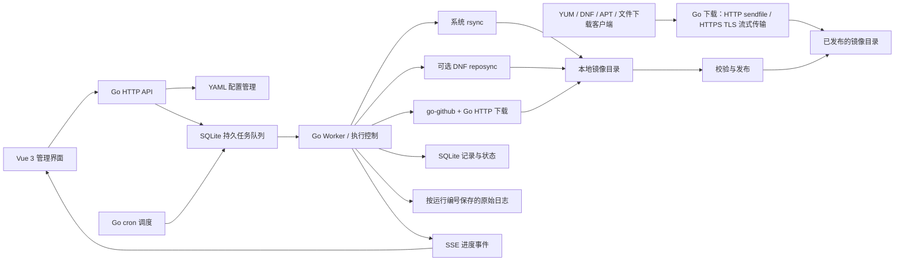

# MirrorDock / 源仓：系统设计

日期：2026-09-30；最新修订：2026-10-01。状态：Go 1.27.1 / Vue 3 已实施；实际数据模型、接口与验收边界见 [IMPLEMENTATION.md](IMPLEMENTATION.md) 和 [ACCEPTANCE.md](ACCEPTANCE.md)。本文保留设计目标，未实现的扩展不等同现版功能。

## 1. 范围与交付目标

单台 Linux 主机运行 Go 服务与 Vue 3 管理界面。通过系统 rsync、可选的 DNF reposync、Go GitHub API 客户端将指定的软件源或 Release 资产同步到本地目录，由同一个 Go 进程提供 HTTP/HTTPS 镜像下载服务、管理 API 和前端静态文件。同步成功且包含完整仓库元数据后，客户端可直接将下载地址配置为 YUM/DNF/APT 源；GitHub Release 则提供资产文件下载。

2026-09-30 修订：rsync 任务统一调用系统 rsync，GitHub Release 使用 `google/go-github` 配合 Go HTTP 下载器；reposync 作为用户可选类型，提供 NGINX Stable EL9/x86_64 案例。配置不包含 version、timezone、并发数、执行文件路径、GitHub 排序方式、环境变量凭证或 records 设置。rsync 来源使用源级 src1/src2/src3，目标使用 dest，exclude 移到源级。Docker CE 与 Kubernetes 使用待用户填写上游的 rsync 案例，每个源通过 type 自行选择执行方式。

第一版完整包含：源配置 CRUD、手动执行、cron 计划、暂停/继续/取消、默认 8 小时超时、SQLite 状态与记录、成功和失败记录分栏、详情日志、阶段进度/速度/耗时/预计剩余时间、YAML 配置读写、`-f` / `--config` 启动参数，以及镜像 HTTP/HTTPS 下载与 TLS 证书/私钥配置。同步类型有独立表单，不要求用户输入任意 Shell 命令。

规模按少量管理员、数十个同步源、大量文件设计。并发控制使用程序内置默认值，暂定最多并行 2 个任务，不暴露配置字段；同一源和有交集的目标目录不可并发。SQLite 为本地磁盘数据库，镜像文件可位于独立的大容量磁盘。

2026-10-01 性能要求：镜像下载以单机可持续吞吐、低 CPU/分配开销和同步期间的服务稳定性为优先。在程序自带 HTTP/HTTPS 服务的约束下，明文 HTTP 优先保留 Linux sendfile 路径，HTTPS 使用优化的 Go TLS 流式路径；技术名称不能替代目标机器上的测量。下载并发与上面的“最多 2 个同步任务”是不同资源池，下载不受该数字限制。具体传输边界、缓存、资源隔离与压测门槛见 ADR-010 和第 11.1 节。

## 2. 总体架构



采用模块化单体，无需 Redis、独立消息队列或微服务。Go 进程负责调度、执行控制、配置读写、进度汇总、API、嵌入的 Vue 构建产物和镜像文件下载。管理与下载共用 listen/port：/ 是镜像目录首页，/<dest>/ 直接提供镜像内容，管理界面位于 /admin/，API 位于 /api/；配置 tls.cert/tls.key 时共用 HTTPS 监听。每个 Runner 统一提供预检查、运行、停止和进度事件；rsync 与 reposync 封装命令与输出解析，GitHub Runner 封装 API 查询与原生 HTTP 下载。

SSE 每秒合并一次进度更新；SQLite 每 5 秒保存一次进度快照，关键状态立即落库。这些间隔为内置默认值，不在 YAML 中配置。SSE 断线后先重新读取数据库快照，再恢复事件连接，日志通过分页/游标读取。读写配置与传输任务互不阻塞。

## 3. 同步引擎与源类型

| 类型 | 第一版实现 | 适用范围 |
| --- | --- | --- |
| `rsync` | Go 安全启动系统 `rsync` | 用户配置的 rsync 上游；案例包括 AlmaLinux、Docker CE |
| `reposync` | Go 启动系统 `dnf reposync`，使用任务私有配置 | 用户选择的 RPM 仓库；案例为 NGINX Stable EL9/x86_64 |
| `github_release` | `google/go-github` 查询 Release/资产，Go HTTP 下载器传输文件 | OpenList 等 GitHub Release 资产 |

每个源的 type、上游地址和本地目录均由用户配置，系统只检查字段是否符合对应执行器的要求，不依据名称决定工具。Docker CE 与 Kubernetes 的 rsync 地址为占位值，默认不启用；用户替换为实际使用的上游后可启用。Docker CE 案例同步的是 RPM 软件包，不包含 Docker Hub 容器镜像。AlmaLinux 的 src2/src3 同样是占位值，部署前替换或删除。

### ADR-001：rsync 任务完全使用系统 rsync

用户选择统一使用系统 rsync。Go 负责组装参数、安全启动、进度解析、超时与状态持久化；传输由系统 rsync 执行。启动时从系统 PATH 查找 rsync，YAML 不指定可执行文件路径，不提供原生 Go 实现或 engine 选择。

启动时检测实际 rsync 版本及所需选项，对缺少依赖的源给出预检查错误。目标主机必须使用支持所选进度/超时选项的 Samba rsync，不能仅凭存在一个同名可执行文件判定可用。rsync 源依赖系统 rsync，reposync 源另外依赖 DNF4 与 dnf-plugins-core；仅为配置了该类型的源检查对应依赖。GitHub 同步由 Go 实现。

建议参数由字段生成：递归、保留链接/时间/权限/硬链接、`--delete`、`--partial-dir=.rsync-partial`、`--delay-updates`、`--info=progress2`、`--stats`、`--outbuf=L`、`--timeout`、`--contimeout`。源级 rsync.preserve_links/times/permissions/hardlinks 与 delete 默认均为 true；这些选项保留为可覆盖字段，省略时继承内置默认值。默认不保留上游属主或设备文件。删除范围限制到源专属工作目录，exclude 的文件保持 rsync 默认的删除保护语义，不附加 --delete-excluded。延迟更新只有逐文件提交语义，整仓库对外发布由独立的暂存与发布流程完成。

settings.rsync.limit_mb 表示每个 rsync 任务的 MB/s 上限，1 MB = 1,000,000 字节，不是 Mbps；0 不限速，支持非负小数。Go 将其换算成 rsync 接受的限速参数，按能力检查的结果处理单位与精度，不把 MB 数值直接当作 KiB 传入。

### ADR-006：按源指定本地 UID/GID

源级 rsync.uid 与 rsync.gid 是可选的数字身份字段，指定后通过系统 rsync 的 --chown 映射所有接收对象的本地属主/属组。两项均省略时不传 --chown、--owner 或 --group，由接收进程与目标目录的系统规则决定新文件身份，不沿用上游身份。两个字段均可单独指定，0 是合法 root 身份；配置模型使用可选值区分“省略”与 0，校验整数类型及目标系统支持的范围。

两项均指定时生成 --owner --group --chown=1000:1000；仅 UID 时生成 --owner --chown=1000；仅 GID 时生成 --group --chown=:1000。显式添加对应 owner/group 选项以兼容需要这些选项的 rsync 版本；不启用未指定一侧的上游身份保留，不混用 usermap/groupmap。配置作用于同一源的所有 srcN 和后续增量运行，并不只影响新下载文件。

改变 UID 通常要求接收端 rsync 以 root 身份运行，改变 GID 要求具有设置该组的权限；普通用户不能任意更改文件身份。执行前检查 rsync 对 --chown 的支持与运行身份权限，不能把未生效的映射当作成功。身份/权限错误作为本地错误停止，不切换来源。未指定身份时继续按普通服务用户运行，不在程序中自动 sudo 或改变服务身份。

### ADR-002：多来源切换与共同超时预算

rsync 源在源级配置 src1、src2、src3，允许继续添加 src4 等；按数字升序尝试，缺号时跳过未配置项，至少有一个非空来源。srcN 必须指向同一仓库、版本、架构与相对目录结构，所有候选共用 dest、exclude 与 rsync 选项。Go 解析这些动态字段并校验其他未知字段，避免 YAML 拼写错误被静默忽略。

同一轮任务从第一个来源开始，上游连接失败、I/O 超时或远端传输失败时，在剩余预算内切换下一来源。先停止并等待旧 rsync 进程组完全退出，再启动新 attempt。沿用同一个 run ID、本地目录及 partial 数据，每次重新扫描并调整估算进度；成功后停止切换。详情记录每次 attempt 的 src 名称、脱敏地址、耗时、退出码与失败原因；src1 失败但 src2 成功时本轮记 succeeded，保留之前的失败尝试供排查。

task_timeout 的 8 小时是整轮累计执行预算，包含准备、扫描、传输、校验与来源切换开销；切换、重连或暂停后继续都不重置。所有候选失败而预算尚有剩余时记 failed，不无限循环；预算耗尽记 timed_out。目标磁盘不足、目标权限错误、配置无效、用户暂停或取消直接停止，不靠切换远端规避本地问题。

### ADR-007：reposync 作为可选 RPM 同步执行器

工具及 type 的名称统一为 reposync，EL8/EL9 使用系统 dnf reposync，执行文件从 PATH 查找。NGINX 案例采用官方 Stable 仓库的 EL9/x86_64 目录与官方签名公钥，默认 enabled=false。源级 src1 是 HTTPS RPM 仓库 baseurl，dest 沿用 mirror_root 下的相对目的地；reposync 块配置 repo_id、releasever、basearch、architectures、download_metadata、newest_only、delete、gpgcheck、gpg_keys 与 module_hotfixes。rsync 的 exclude、limit_mb 与 UID/GID 映射仅适用于 rsync 类型。

Go 将字段生成到任务私有 .repo 与 DNF 配置中，仅启用选定仓库，不修改宿主机 /etc/yum.repos.d。私有缓存与 RPM 密钥库置于任务数据目录，签名密钥导入在预检查阶段完成，避免无人值守时等待确认。gpgcheck=true 同时写入仓库配置并传 --gpgcheck，签名失败记为任务失败；包签名检查不宣称已验证上游仓库元数据签名。module_hotfixes=true 对应 NGINX 官方仓库配置，避免模块过滤影响包选择。

执行参数包含 --repoid、--download-path=<本轮工作目录> 与 --norepopath，使包与 repodata 保持仓库根布局；成功后发布到 dest 对应的镜像地址。download_metadata 默认 true，newest_only 默认 false，delete 默认 true；reposync 的 delete 只清理上游已不存在的 RPM 包，不具有 rsync 对任意文件的删除语义。完整 metadata 搭配 newest_only=true 会保留指向缺失旧包的索引；第一版完整镜像模式校验并拒绝这个组合。

任务使用同一状态机、目录锁与 8h 累计预算，停止整个进程组；暂停后继续重新执行 reposync，复用已有有效包。这个案例只配置 src1，不承诺复用 rsync 的多来源切换或 --chown 行为。执行能力检查针对 DNF4/EL8/EL9，不能将 DNF5 的不同命令参数直接套用到这个执行器。

### ADR-003：GitHub Release 使用 Go 库与 HTTP 下载器

采用用户已确认的 `github.com/google/go-github` 作为 GitHub REST API 客户端，实施时选择与项目 Go 版本兼容的稳定版本并固定在 go.mod/go.sum。该库提供 `Repositories.ListReleases`、`Repositories.ListReleaseAssets`、`Repositories.DownloadReleaseAsset`，支持 context 取消与 API 鉴权。它负责 API 访问，不负责应用的调度、持久记录、进度统计或自动断点续传；这些由本项目实现。

“前 N 个 tag”定义为最近发布的 N 个符合条件的 Release，按 `published_at` 降序；默认排除草稿和预发布。它与“没有 Release 的 git tag”不同。系统设置 `release_count` 默认 5，单个源可以覆盖。通过库分页取得列表，在 Go 内过滤、排序并选择资产，不把 API 返回顺序当作语义版本排序。每次运行固定 release/asset 清单，避免中途新版本改变总量。

仅同步 Release assets，按 glob 筛选；移除源码压缩包选项及下载分支，不处理 Release 自动生成的 Source code (zip/tar.gz)，不查询或下载 zipball/tarball/archive 地址。用库获取资产响应流或下载重定向地址，由 Go HTTP 下载器写入 `.part` 暂存文件并统计已写字节。使用任务 context 取消查询和传输，连接/I/O 等待使用程序默认值，并把 API 限流响应转换为可见的等待/错误事件。Token 直接读取 settings.github.token，空值使用未认证公开访问，不提供 token_env 机制。settings.github.proxy 可配置 HTTP/HTTPS/SOCKS5/SOCKS5h，API 与附件下载共用，空值直连，不读取系统代理变量；故障不绕过代理。按用户 2026-10-01 新要求，完整代理地址可通过受登录保护的配置 API 读取并直接编辑；代理认证仍不进入快照、审计或日志。API 鉴权与下载重定向分开处理，不把 API Token 附加到第三方存储地址。

下载完成后验证期望大小，并在有可信 digest/校验清单时校验内容，成功后原子改名到最终文件。数据库记录 release ID、asset ID、更新时间、大小、digest、ETag/Last-Modified（可用时）及已完成结果；不能只凭同名文件存在跳过损坏或已替换的资产。

暂停取消 HTTP context 并保留 `.part` 文件，继续先校验资产身份和本地已写长度。仅在下载服务支持 Range、返回匹配的 206/Content-Range，且资产未变化时续传；收到 200、范围不匹配、资产变更或无法确认版本一致性时截断暂存文件并重新下载。重新通过 API 获取下载地址，不能持久依赖会过期的重定向 URL。完整且验证通过的资产直接复用。SDK 本身不承诺断点续传，兼容行为需通过项目验收。

目录：`mirror_root/github/openlist/<安全编码后的 tag>/<安全文件名>`。tag 和资产名须处理斜杠、`..`、控制字符及碰撞，禁止直接拼接成路径。同步最近 N 个不等于删除更早的本地版本；默认 `prune_old_releases: false`，开启后也仅在本轮成功之后清理应用明确拥有的历史版本目录。

## 4. 配置协议与写回

示例：[../configs/config.example.yaml](../configs/config.example.yaml)。配置协议以用户本次要求为准：

```text
mirrordock -f /etc/mirrordock/config.yaml
mirrordock --config /etc/mirrordock/config.yaml
```

两种旗标为同一个参数；同时传入不同值时报错。没有显式参数时读取工作目录中的 `config.yaml`，缺失时报明确错误。显式路径不存在、格式错误或不可读不回退。启动时解析并记录所选配置的绝对路径；内部相对路径以配置文件目录为基准。`listen` 是地址，`port` 是管理与镜像下载共用的端口，示例 listen=0.0.0.0 便于其他机器访问。`path` 是数据库与日志目录，数据库文件固定为 `<path>/data.sqlite`。镜像位置单独使用 `mirror_root`；源级 dest 为 mirror_root 下的相对目录，直接对应 /<dest>/，禁止嵌套或重叠写入目录。dest 首级目录 admin 和 api 为程序保留路由，配置校验禁止占用。

tls.cert 和 tls.key 为 PEM 证书链与匹配私钥的文件路径，路径同样相对于所选配置文件目录。两项均空使用 HTTP；两项齐全使用 HTTPS；只有一项、文件不可读或证书/私钥不匹配则启动失败，不静默退回 HTTP。加载服务端证书后使用 Go net/http 的 TLS 监听，最低 TLS 版本采用 1.2，支持 1.3。证书域名与客户端访问域名匹配，客户端需要信任证书链；第一版使用用户提供的证书文件，不增加自动签发配置。

rsync 的 srcN 与 exclude 位于源级，reposync 类型的 src1 同样位于源级并表示 RPM 仓库 baseurl，github_release.repository 保留 owner/repo 格式。源级 rsync 块可以省略；默认保留链接、修改时间、权限、硬链接，并默认开启删除；uid/gid 可选，不默认指定身份。所有 Release 固定按 published_at 从新到旧选择，不暴露 order_by，不包含源码压缩包选项。配置无 version、timezone、max_concurrent_tasks、executable、token_env 或 records 段；reposync 仅配置在对应源下。Token 存于 YAML，API 读取、运行快照、审计及日志均脱敏；前端设置只展示是否已配置，更新时提交新 Token。

2026-10-01 追加程序日志协议：顶层 `log.level`（debug/info/warn/error，默认 info）、`log.path`（日志文件路径，默认空表示标准输出）、`log.format`（json/text，默认 json）。日志文件相对 YAML 所在目录，自动创建父目录并追加写入，不自动轮转；可用 logrotate copytruncate 或停机归档。使用标准库 slog，在应用初始化前设置 logger，HTTP 内部错误共用该 logger；日志修改后重启生效。文件日志隔离镜像根、YAML、数据库、实例锁和 TLS 文件。任务原始日志格式及路径不变，下载热路径不新增日志操作。

### ADR-004：YAML 是配置唯一真源，SQLite 保存运行事实

管理账号同样以 YAML 为唯一来源：

```yaml
auth:
  username: "admin"
  password: "请替换为你的密码"
```

两个字段必须非空；用户名最多 128 字节且不允许首尾空白或控制字符，密码最多 72 字节。程序启动时从配置生成内存中的 bcrypt 校验值，登录要求用户名与密码匹配；没有初始化码、设置密码 API 或 SQLite 密码回退。账号修改后重启生效，会话随重启失效；外部修改并重新载入配置时标记需要重启。读取 API 隐藏密码，页面保存其他设置时保留完整 auth，不通过页面修改账号。

源定义、系统设置、计划存于 YAML；状态、执行历史、日志索引、资产清单和配置变更审计存于 SQLite。数据库中的执行配置快照用于追溯历史，不作为另一份可编辑源配置。

Web 新增 RockyLinux 时更新启动时选定的 config.yaml。流程：校验字段和目录 → 对配置管理器加锁 → 检查文件 revision/hash → 按 YAML 节点修改并尽量保留注释 → 在同目录写临时文件并 fsync → 原子 rename → fsync 目录 → 更新内存配置 → 更新 scheduler → 写审计结果 → 返回新 revision。配置不可写时保存失败，不能假装成功。API 使用 revision 防止两个浏览器或人工编辑覆盖对方修改；文件路径为 symlink 时要明确处理，不盲目替换链接。

外部编辑通过“重新载入配置”按钮应用，第一版无需文件监听。无效新配置不替换当前有效配置；删除源仅移除定义，执行记录保留其名称和快照。运行中的任务使用启动时配置快照；新的数量、超时及选项从下一次运行起生效。listen、port、path、mirror_root、tls.cert/tls.key 等影响监听、证书或目录锁的设置只通过配置文件修改，重新载入后标记“重启生效”；替换同一路径的证书文件也通过重启重新读取。配置保存以 YAML 持久化成功为准；若审计失败显示相应异常，重启后从 YAML 重建调度。

### ADR-008：同进程提供镜像下载与 TLS

下载路径直接为 /<dest>/，与管理页面 /admin/ 和受鉴权的 /api/ 共用一个 HTTP/HTTPS 监听，不额外增加 mirrors 前缀。镜像 GET/HEAD 默认允许匿名读取，适配包管理器；其余方法返回 405，不支持通过下载路由上传或删除文件。/ 是镜像目录首页，仅列出已发布的源及其公共父目录；例如 dest=almalinux/9 时可从 /almalinux/ 浏览到 /almalinux/9/。文件链接保留仓库相对布局；未知文件和未完成的首次同步返回 404，不回退到 Vue 页面或登录页。NGINX 案例的源根地址为 https://mirror.example.com:8080/nginx/el9/x86_64/，AlmaLinux 的 DNF baseurl 指向其中 BaseOS/AppStream 等实际包含 repodata 的子目录。

路由先匹配 /admin/ 与 /api/，再匹配已登记的源及虚拟父目录。Vue 的构建 base、路由 history base、资源路径与登录跳转统一为 /admin/；SPA 回退只作用于该前缀。源码、静态资源与 API 不占用其他根目录；dest 的首级目录禁止使用 admin、api，无需增加下载前缀配置字段。

使用 Go net/http 提供文件流，打开文件后交给 ServeContent 处理 Range、HEAD、Last-Modified 与条件请求；提供与文件版本一致的 ETag/If-Range，避免断点续传拼接不同版本。包和资产按文件流发送，不整文件读入内存。按 ADR-010 保留 HTTP/1.1 的 sendfile 快速路径；HTTPS 与 multipart Range 明确使用相应流式回退路径。下载使用独立的内部并发与缓冲限制，长文件传输不套用管理 API 的短响应超时，也不计入同步任务的 8h 预算。客户端中断取消该下载请求；停机时下载与同步分别优雅关闭。

不能将裸 http.Dir 直接映射到 mirror_root：其符号链接与文件枚举语义不足以保护私有文件。按已发布的源注册受限文件根，采用支持抵抗路径穿越和符号链接竞态的文件打开方式（实施时根据 Go 版本使用 os.Root 等），允许根内有效链接，拒绝越界链接与路径。只发布配置内登记的源，不开放整个宿主机目录。配置文件、SQLite、日志、TLS 私钥须位于所有已发布源目录之外，启动和修改配置时校验真实路径；不公开 .rsync-partial、.~tmp~、.part 或内部发布目录。目录列表转义文件名，文件响应设置 nosniff，并将上游可能执行的 HTML/脚本等作为附件下载，避免与同源管理页面共享执行权限；Linux 源合法的 .treeinfo 等元数据仍可按实际路径下载。

TLS 配置只增加 cert/key 两个路径字段。填齐后使用同一端口的 HTTPS；两项均空使用 HTTP。加载失败则启动报错；私钥内容不出现在读取 API、日志、审计或运行快照中。HTTP/HTTPS 模式切换及证书替换通过重启应用，不额外增加 HTTP 跳转端口。侧栏“浏览镜像目录”入口按当前服务协议与访问地址打开公开目录；TLS 传输与 RPM/APT 包签名验证分别保留各自职责。

### ADR-009：同步成功后发布，下载不读取工作目录

引入发布状态，与 run 的执行状态分开保存。程序启动后立即提供已发布镜像；首次部署没有镜像时先完成同步，已有本地目录可在启动校验通过后登记为已发布。RPM/APT 目录能作为源使用的前提是仓库元数据及其引用文件完整；单纯下载部分软件包不会自动生成可用仓库，GitHub 类型只发布附件下载。

更新在 mirror_root 下的私有工作目录进行，任务成功并校验后生成不可变发布目录。已有镜像用于增量任务的基础副本，优先使用文件系统 reflink，不支持时普通复制；不共享会被 chown 或原地覆盖影响的可写硬链接。暂停/继续保存同一工作目录，失败、取消和超时保留上一已发布版本。rsync/reposync 的 delete 在工作副本内生效，不直接删正在提供下载的目录。

发布时先将工作目录封存，再原子更新持久发布指针与下载路由的目录引用；mirror_root/<dest> 是指向当前发布内容的本地入口，替换符号链接用同目录原子 rename，不将两次目录重命名当作原子操作。下载请求固定其打开的发布根及文件句柄，发布不会截断已开始的文件流。当前发布、待恢复的发布意图与上一代目录由 SQLite 和磁盘 manifest 追踪，重启先对账，不能把“下载完成但发布失败”标记为完整成功。

默认保留上一代至少 24 小时且避开活动读取，当前代缺少的旧文件可在保留代中查找，减少旧元数据引用旧包时的 404；这是有限时间的兼容窗口，不保证跨多个 HTTP 请求始终处于同一代。各代文件不原地修改，客户端下载继续校验元数据中的大小与 digest，遇到代切换应重新获取元数据。发布需要工作副本与保留代的额外磁盘空间，预检查纳入空间预算；保留代回收与永久保存运行记录是两套不同规则。

NGINX 客户端示例（该源完成首次同步并发布后使用）：

```ini
[nginx-local]
name=NGINX local mirror
baseurl=https://mirror.example.com:8080/nginx/el9/x86_64/
enabled=1
gpgcheck=1
gpgkey=https://nginx.org/keys/nginx_signing.key
module_hotfixes=true
```

### ADR-010：以高吞吐文件传输为主，按协议选择实际可用的快速路径

**状态与目标**：核心路径已实施；macOS 回环基线已测，Linux 系统调用和生产硬件压测待验收。默认仍为一个 Go 程序直接提供源服务，配置保持当前精简形式。目标是在指定服务器、磁盘和协议条件下逼近可用网络/存储吞吐上限，同时保留正确的 Range、TLS、访问限制和原子发布语义；没有跨硬件、跨协议的无条件“最高性能”承诺。

**传输路径**：

| 请求场景 | 首选路径 | 适用边界 |
| --- | --- | --- |
| Linux 明文 HTTP/1.1，普通文件的完整 GET 或单段 Range | 受限根打开真实 `*os.File` → ServeContent → ResponseWriter.ReadFrom → TCPConn → sendfile | 已知 Content-Length、没有正文变换，文件系统与连接支持；不支持时标准库回退。响应头及可能的少量类型探测数据仍经过用户态 |
| Go 原生 HTTPS，含 HTTP/1.1 和 HTTP/2 | 文件流 → 有界缓冲 → Go TLS 加密 → socket | 当前 Go crypto/tls 在用户态生成并加密记录，不具备上述文件到 TCP 的 sendfile 路径；HTTP/2 另有 DATA 帧和流控，不能直接当作 HTTP/1.1 的路径 |
| 多段 Range | 标准库 multipart 流式响应 | 需要拼接边界与各段正文，不宣称整个响应零拷贝；对范围数量设置内置上限，过量的有效范围请求忽略 Range 并返回完整 200，保留普通断点续传兼容性 |
| HEAD、304 条件命中 | 仅发送响应头 | 不读取或传输整个文件正文 |

这里“零拷贝”特指避免文件正文往返 Go 用户态缓冲的 sendfile 路径，不代表磁盘、页缓存、加密或网卡中完全没有复制。Go 官方 HTTP、io 与 net 源码包含这条调用链；实施时以锁定的 Go 版本与 Linux 系统调用观测再次确认，不能仅凭使用 io.Copy 或 ServeContent 就声称已命中。

**避免破坏 sendfile**：

- 文件服务独立于管理 API 的鉴权、JSON、压缩和数据库中间件，直接使用标准库文件处理。完整文件和单段 Range 保留真实文件及 LimitedReader 的形态，不套逐块计数 Reader、TeeReader、整文件 bytes.Reader 或无必要的 SectionReader。
- 不向镜像文件套动态 gzip/Brotli；RPM、DEB、压缩索引和 Release 资产按原有字节发送，确保 digest、Content-Length 和 Range 一致。Vue 中带内容哈希的静态资源可在构建时预压缩，走独立管理资源处理。
- 尽量透传原始 ResponseWriter 与连接。确需响应计数包装时保留并正确委托 io.ReaderFrom 及所需可选接口，按委托返回的实际字节数计数；只提供 Unwrap 并不会自动使 io.Copy 使用底层 ReaderFrom。包装前后都必须证明 sendfile 路径仍存在。
- 每个请求独立打开文件，固定本次发布代与文件句柄；不让多个 Range 请求共享可变 Seek 偏移。不直接 Hijack HTTP 连接或向 TLS 的底层 TCP 写明文，不另写绕过标准库流控/取消机制的裸 syscall 发送循环。

**HTTPS 优化**：保留 Keep-Alive、TLS 会话恢复及 Go 默认的现代密码套件和可用硬件加速；支持 HTTP/2，并与 HTTP/1.1 分别测量大文件和小元数据场景，不假设某一版本在所有负载下都更快。保留标准库已有的缓冲复用，在回退路径需要额外缓冲时使用有界固定规格池；32/64/128 KiB 等规格以 CPU、分配与吞吐结果选择，不为每条下载预分配数 MB。sync.Pool 只是减少重复分配的工具，实际内存边界由缓冲规格、活动流数量和缓存总预算保证。TLS 自适应记录大小与固定最大记录仅作为同机对照项，只有整体收益明确才改变默认，管理 API 的延迟也参与评估。

**缓存与请求成本**：

- 文件正文交给操作系统页缓存，不把大包另缓存进 Go 堆，不默认 mmap、O_DIRECT 或启动全库预读。优先利用热门文件自然形成的页缓存；冷数据瓶颈交给磁盘/文件系统与测量结果处理。
- 发布完成后构建不可变的源路由与发布根快照，通过原子引用替换。普通文件请求只在内存中匹配源、取得发布代、受限打开文件并发送；不查询/写入 SQLite、不读取 YAML、不等待同步任务锁、不在全局锁内传输。发布根按活动请求引用计数回收。
- 大仓库不把所有文件元数据和内容一次装入内存。大小、时间、MIME、ETag 与目录列表使用按发布代/相对路径区分的有界缓存；目录分页/有限列举，缓存失效随发布切换，负缓存采用短有效期并有条目上限。
- ETag 在发布/首次元数据取得时生成并缓存，可使用已验证 digest，或由不可变发布版本与文件身份形成稳定的版本标识。哈希检查放在同步与校验阶段，不能每次下载重新 SHA-256 整文件。受限打开后仍检查文件身份与属性，缓存不能取代访问边界。
- repomd.xml、Release/InRelease、目录首页及版本可变路径使用可重验证缓存策略，避免客户端长期持有旧索引；只有能够保证同一路径内容不变的内容寻址/唯一版本文件才使用长缓存和 immutable。默认不把所有 RPM 文件名视为永久不可变。

**并发、慢客户端与同步竞争**：

- 下载流、元数据请求、管理 API 与同步 worker 分开准入。下载容量根据可用文件描述符、每流内存和目标机器压测确定内置上限，为管理/小元数据请求预留资源；过载及时返回 503 与 Retry-After，不无限排队或创建无限 goroutine。默认不对正常镜像下载增加每文件限速；settings.rsync.limit_mb 只限制上游 rsync 同步。
- 设置 ReadHeaderTimeout、IdleTimeout 与头大小上限；大文件不使用从请求开始计时的统一短 WriteTimeout。传输停滞期限用独立的无进展监测/适用协议的响应控制实现，并验证不会为了监测把 sendfile 改成逐块复制，也不会误杀 HTTP/2 同连接上正常进展的其他流；正常低速且持续前进的下载可继续。
- 准入只隔离应用资源，不能消除同盘同步的磁盘竞争。Linux 同步子进程采用较低 CPU/I/O 调度优先级，并在支持的部署环境中给同步进程组单独设置 cgroup I/O 权重；Go 内的 GitHub 下载/校验使用有界工作量和缓冲。发现持续下载延迟/存储排队上升时延后启动下一同步阶段/任务，不强制中断已经运行的 rsync；网络竞争按已有 rsync limit_mb 和实测评估。
- reflink 暂存避免每次更新复制全库正文，无法 reflink 时普通复制可能成为主要 I/O 成本，必须单独压测并在预检查中显示文件系统能力。发布校验复用本轮已验证的大小/digest与未变文件的可信验证结果，不无条件重新哈希整库；变化文件仍验证，不能用性能目标绕过完整性检查。
- 下载统计采用内存计数和定期聚合，只记录必要的请求结果与错误；不逐数据块写日志或 SQLite。单请求日志不阻塞传输线程，异步队列有界，队列满时保留聚合错误/丢弃计数，不能拖住文件发送。原有同步运行记录及原始任务日志继续按既定规则保存。

**最高性能的选择方式与替代方案**：

| 方案 | 取舍 |
| --- | --- |
| 默认：Go 自带服务，HTTP sendfile / HTTPS 优化流式传输 | 满足“启动一个程序即可当源”；标准库兼容、安全和维护成本可控，实际吞吐通过第 11.1 节验收 |
| 后续可选：NGINX 直接发送已发布文件，Go 管理与同步 | 可评估 sendfile、kTLS/SSL_sendfile 和硬件 TLS 卸载；多一个服务，需复刻受限路径、临时目录隐藏、发布代固定及旧代读取语义。应由 NGINX 直接打开发布文件，单纯反向代理 Go 的文件流不会自动让 Go HTTPS 变成零拷贝。当前不增加必需依赖或配置字段 |
| 自研 Go kTLS、io_uring 或专用网络栈 | 只有 profiling 证明现有路径是瓶颈且对照实验收益充分时再立 ADR。kTLS 需要 TLS 库与内核协同处理记录、密钥更新和回退；内核支持 kTLS 不等于 Go crypto/tls 自动启用，也不保证端到端无复制或普遍更快 |

优先在现有约束下选择实测吞吐最高、资源成本合理且协议正确的路径；HTTPS 若在目标服务器被加密 CPU 限制，再用直接文件服务的成熟 kTLS 方案对照，不把降低 TLS 安全性、绕过文件根限制或无限并发作为优化手段。

## 5. 运行生命周期与调度

```text
queued → running → succeeded
                 → failed
                 → timed_out
                 → cancelled
running → pausing → paused → queued → running
running / pausing 在服务异常终止后 → interrupted
```

`phase` 单独表示准备、扫描、传输、校验、发布、完成，避免把扫描/下载阶段与运行状态混为一谈。校验与发布也消耗任务累计预算，完整成功在发布完成后落库。对 GitHub 等多子项任务，部分资产失败时整体标记 failed，摘要展示已成功/失败/跳过的真实子项统计；成功下载的子项尚未发布时在详情中明确标记。rsync 的总失败文件数无法可靠解析时保留未知，不能由退出码伪造失败数量。空 Release 没有匹配资产时记为 skipped 子项，并解释筛选结果。

队列持久化在 SQLite，worker 通过事务领取 queued 任务，确保 UI 重复点击或计划重叠不会重复写同一目录。目录锁覆盖相等目录、父子目录以及解析真实路径后的别名。暂停任务保留目标目录预留，防止另一任务写入；手动重复触发返回已有运行编号。计划重叠默认 skip，并留下触发事件。机器停机错过的计划默认不补跑。

程序启动时读取进程本地时区（部署环境 TZ 或操作系统时区），保存为该进程生命周期使用的 location，不从浏览器识别、不在 YAML 配置，重启后重新读取。通知作为独立功能使用最近登录浏览器同步的 IANA 时区，保存于 SQLite；不改变本节调度与页面时区。cron 解释、下次运行计算与页面时间显示统一使用这个时区；数据库时间仍存 UTC。GET /api/system/info 返回启动时区标识与偏移信息，前端据此渲染，不能再次套用访问者的浏览器本地时区。支持夏令时的地区使用对应时区规则，不能把某一刻的 UTC 偏移当作全年固定偏移。

### ADR-005：暂停采用停止后重新进入增量流程

暂停先写 pausing，再停止执行器并等待释放写入资源，最后持久化 paused。rsync 与 reposync 停止整个进程组，GitHub Runner 取消 HTTP context 并关闭响应流/暂存文件；不会给网络进程无限 SIGSTOP。继续沿用同一个 run ID，新增 attempt，在剩余超时预算内重新启动；rsync 从已保存的当前候选来源继续增量流程并利用 partial 数据，reposync 复用已有有效 RPM 包，GitHub 下载器复用已验证资产，并按服务端支持情况续传 `.part`。新一轮手动执行或失败重试从第一个来源开始。UI 不承诺 TCP 连接保持或所有下载均从字节断点恢复。

失败记录的“重试”新建 run 并关联 parent_run_id，旧记录不可覆盖。重试默认使用原始配置快照；可另选当前配置。取消为终态；继续只对 paused 可用。禁用计划不取消已运行任务。

### 超时与进程控制

系统默认 `task_timeout: 8h`，适用于 rsync、reposync 与 GitHub 三种任务，可在系统设置修改。定义为本次运行累计执行时间，包含准备/扫描/传输/校验/发布及来源切换，不含排队与暂停；继续与切换不重置 8 小时预算。另设 rsync I/O 超时和连接超时。`rsync --timeout` 是 I/O 无数据期限，不是整次同步最长时间。客户端从镜像下载的耗时不属于同步任务预算。

Go 负责截止时间与上下文取消。rsync 与 reposync 需要进程组终止、输出排空和 wait；先发停止信号，宽限 10 秒后强制结束整个组。单纯 CommandContext 默认只处理主进程不足以覆盖所有子进程。Linux 使用进程组、父进程死亡信号和 systemd 进程组回收作为组合措施；启动恢复先确认没有遗留写入者再重新领取任务。GitHub 查询和下载通过 HTTP context 取消并等待下载 goroutine 退出。停止原因优先从本地意图判断，正常的暂停/取消不因进程非零退出码或 context 取消误记失败。

服务重启后 queued 保留，paused 保留，未完成运行确认停止后记 interrupted；不声称先前 PID 一定仍属于本任务，也不默认重新执行 interrupted。通过详情里的重试创建新运行。应用和 worker 单实例锁避免两个进程写同一个数据库及镜像根。

## 6. 进度与耗时

前端显示实际执行时长、速度、百分比、预计剩余时间；详情同时显示排队和暂停时长。

| 引擎/阶段 | 度量方式 | 未知总量时 |
| --- | --- | --- |
| rsync 扫描 | 已发现文件数/大小；增量递归总量可能继续变化 | 显示扫描中，百分比及 ETA 留空 |
| rsync 传输 | 解析 progress2；标记为引擎报告的估算进度 | 估算值可修正，不能宣称全任务精确字节比例 |
| reposync | 可取得完整包清单时统计包数与大小；否则解析可确认的完成包数 | 显示已处理数量，百分比/ETA 留空 |
| GitHub Go 下载 | 固定资产清单总字节；已完成文件 + 当前实际写入/有效续传字节 | 缺少可信大小时只显示已下载字节与速度，百分比/ETA 留空 |
| 校验 | 校验完成项 / 待校验项 | 未知则显示校验中 |

传输阶段结束并不等于任务成功。任务尚在校验/命令尚未成功退出时不可显示整体 100% 与成功状态。ETA 使用已知剩余工作量和窗口平均速度估算，停滞、未知总量、暂停或扫描阶段显示 `—`。暂停后的新 attempt 重新扫描时保留上一次进度快照供查看，但当前进度注明重估。

命令解析器同时处理 stdout 的 CR/LF 进度行、stderr 错误、长行以及版本/区域设置差异。执行环境固定 locale；保留原始日志作为排查证据。GitHub 下载器直接统计有效文件字节，重试时不把重复传输字节计入完成比例。用事件类型表示进度是 `estimated`、`exact` 或 `unknown`，避免 UI 将所有引擎数据展示成同一精度。

## 7. SQLite 与记录

数据库建议使用 database/sql 搭配 pure Go SQLite 驱动，启用 WAL、foreign_keys 与 busy_timeout。写事务保持短小，状态转换立即提交，进度批量节流。数据库存储在本地文件系统；按部署磁盘特性决定同步等级并记录，备份使用 SQLite 一致性备份方式，不直接复制仍在写入的单个 data.sqlite。

数据库初始化语句内置在 `internal/database`，程序启动时自动创建数据库、表和索引，重复启动保留已有记录，无需独立 SQL 文件或手动初始化。

| 表 | 主要字段/职责 |
| --- | --- |
| runs | id、source_id/name/type、trigger、state、phase、created/started/finished_at、active/paused/queued_ms、百分比精度、字节/文件数、退出码、错误码、parent_run_id、完整非密钥配置快照 |
| run_attempts | run_id、attempt、src 名称与脱敏地址、started/stopped_at、stop_reason、累计运行时间、退出码与错误摘要、执行器版本、命令与脱敏参数 |
| run_events | 状态变化、计划重叠、配置变更等结构化事件及时间 |
| run_items | 有意义的包/Release/资产子项结果，含可追溯名称、大小及校验状态；不为每次进度帧写记录 |
| assets | Release/asset 标识、源、已验证版本、大小、digest、相对路径及下载时间 |
| mirror_publications | source_id、dest、generation、发布状态、不可变目录路径、manifest、published_at、上一代与回收期限 |
| config_changes | revision、actor、脱敏变更摘要及时间，不保存 token |
| schema_migrations | 数据库 schema 版本 |

rsync 与 reposync 的原始 stdout/stderr 和 GitHub Runner 的 API/HTTP 事件写 `<path>/logs/<run-id>/<attempt>.log`，SQLite 保存索引、状态、错误摘要和关键事件。GitHub 日志记录 HTTP 状态码、请求 ID（可用时）、资产 ID 与校验结果，不记录 Token、完整签名下载 URL 或资产二进制内容。成功/失败/暂停等必须在数据库中保留；没有必要把数 GB 的原始传输输出塞入 SQLite。

记录与原始日志默认一直保留，不配置自动过期策略。运行记录页增加“清理日志”按钮，清理已结束运行的原始日志，跳过 queued/running/pausing/paused 等仍可继续的运行；不删除 SQLite 历史、错误摘要或同步文件。操作与日志写入共用运行锁，数据库保存日志已清理标记，详情明确显示“日志已手动清理，运行记录已保留”。

“运行记录”的成功页读取 succeeded 的执行与成功子项；失败页读取 failed/timed_out/interrupted 的执行与失败子项。部分失败运行的成功子项仍可在成功子项视图查到。暂停/排队/取消在批次记录中展示，避免误归成功。UI 明确区分“一次运行记录”和“文件/包/资产子项记录”。

## 8. 页面与视觉方案

保留截图的应用侧栏、页面标题、筛选栏、按日期分组的批次时间线、成功/失败标签页以及行尾详情按钮。按用户要求移除整个顶部面包屑、LOCAL MIRROR 和时区栏，手机保留独立的侧栏导航按钮。截图最左侧属于浏览器的侧栏不属于系统页面，不复制。原图的模型、token、视频相关菜单替换为同步概念。

2026-10-01 管理界面精简：移除各管理页标题下说明、侧栏品牌副标题和连接/版本状态栏、批次预算说明、计划管理的调度时区提示行及同步源页底部发布说明。系统配置入口并入系统设置，在 GitHub Release 后添加一个系统配置页签，包含配置文件与环境检查，取消运行环境和监听与存储面板。

2026-10-01 同步源与标签调整：表格列为“同步源 / 来源 / 目标 / 最近运行 / 状态 / 操作”，取消镜像发布列及其复制按钮；目标独立显示完整路径，来源省略时保留完整悬停提示，备用来源仍在来源列。最近运行显示原运行创建时间，状态单独呈现，未运行时显示中性标签。状态标签按用户后续参考图采用统一 6px 圆角、语义细边框、浅底色与深文字，成功绿色、运行蓝色、排队灰蓝、暂停/正在暂停琥珀、失败红色、超时深橙、中断紫色、取消/未运行灰色；文字与圆点同时提示状态。同步类型在源和批次共用蓝色 rsync、橙色 reposync、紫色 GitHub Release，类型文字保留。批次按日期分组，取消时间线外围嵌套框与独立卡片边框，采用左侧时间/圆点/连续竖线，批次编号加粗；统计框同为 6px 圆角、浅底色、语义细边框和圆点，完成绿色、跳过琥珀、错误红色。窄屏只在表格容器内滚动，卡片标题换行，沿用现有字体与布局。

2026-10-01 表格对齐调整：同步方式筛选默认文案为“同步方式”，桌面宽度 150px；最近运行日期/时分秒上下显示并共用列中轴，未运行只显示一个 `—`，继续按程序启动时区格式化。管理表格的状态/时间/数值及公开列表表头文字居中；同步源前三列表头、运行记录同步源/处理结果（失败原因）表头改为左对齐，记录详情标题使用与右侧按钮同宽的居中区域。所有下拉菜单宽度跟随触发框，不再设置 180px 最小宽度。公开排序箭头绝对定位在文字右侧，不计入标题居中宽度；状态、数值和时间内容居中，名称/来源/目标目录保持左对齐，操作及记录详情按钮靠右。最近运行列缩为 130px，操作列保留足够容纳三按钮的宽度；手机仍在表格容器内滚动。计划管理同步源表头左对齐，操作表头和按钮居中，下次运行共用日期/时分秒分行组件，日期加深加粗，停用计划仍显示“未启用”。

暂定品牌：MirrorDock，中文“源仓”。Logo 使用两块相扣的镜像切片与双向连接，体现上游和本地的同步。主色钴蓝 #315BEF，背景冷灰 #F7F8FC，正文深墨 #1D263B；绿色用于成功、琥珀色用于暂停/等待、红色用于失败。保持轻边框、细图标、适量留白，避免大块装饰抢占数据密度。深色主题保留相同状态语义。

| 导航 | 内容 |
| --- | --- |
| 同步源 | 源表格、类型、来源、目标、启用状态、最近运行时间、运行状态、立即同步、新增/编辑 |
| 运行记录 | 成功/失败切换、源/类型/日期过滤、错误摘要、详情、重试与清理日志 |
| 计划管理 | cron、下次运行、启停、重叠策略、立即执行 |
| 批次记录 | 日期时间线、运行状态、阶段、耗时、进度、预计剩余、暂停/继续/取消 |
| 系统设置 | Rsync / GitHub Release / 同步执行 / 系统配置 / 通知设置页签；配置文件显示 YAML 路径，环境检查进入时自动读取并可点击刷新重读；累计超时、I/O 与连接超时、MB/s 限速、Release 数量、Token 与 proxy。监听、目录及 TLS 只用 YAML 配置，页面保存保留这些固定字段 |

公开下载目录采用用户选定的文件列表方向：白底紧凑 Header、右侧搜索与白色圆角表格、细分隔线、小尺寸线性图标。列为名称、类型、大小和修改时间，目录优先；Header 由“当前位置”、目录面包屑、列表标题/数量与搜索三层组成，左右边界与表格对齐。面包屑以小房子作为首页入口、Chevron 分隔，祖先可点击、当前目录不可点击并加粗；取消上级目录按钮。长路径在导航内部横向滚动，脚本在首次显示和窗口缩放时优先显示当前目录，超长名称省略且可悬停查看完整文字。列表标题右侧搜索宽 320px、高 38px，800px 以下另起一行铺满宽度；标题行与表格间距 14px。保留当前目录搜索和排序，公开镜像目录不分页。RPM/DEB、归档、JSON/XML 等元数据、签名、校验和及镜像文件共享图标体系。手机优先显示名称与大小。列表最多读取 1000 项，超过上限明确提示搜索范围，文件完整路径下载仍可使用。

2026-10-01 公开列表精简：删除标题说明、类型筛选与页脚（Header 后续按本节三层方案调整）；删除品牌旁“镜像目录”、右上“公开下载”、重复的小面包屑、目录名尾斜杠与行尾操作图标。普通项目行显示状态、大小、上次同步和下次计划；GitHub 信息只放在各 Release 行，资产文件列表保持原列。Release 大小来自当前发布代的独立汇总，同步时间来自成功校验后随发布提交的私有标记，未被本轮选择的版本保留旧时间，旧数据未知则显示 `—`。状态与下次计划属于项目，不冒充单 Release 的独立调度。摘要在发布阶段计算并保存在 SQLite 发布记录，旧代只在首次启动补算；目录请求读取不可变摘要，不递归扫描，普通文件请求保持原热路径。每代最多保留 1000 个 Release 摘要，超出部分显示未知大小和时间。

文件图标采用用户后续指定的 Phosphor Icons Regular 官方 SVG：统一单色、无底色块，桌面 22px、手机 20px，MD/PY/INI 使用带字母的文件图标；资源随 Go 程序嵌入并保留 MIT 授权，不依赖 CDN。

原始日志每 3 秒按字节游标追加读取，单次刷新最多读取 2 MiB，页面只保留当前 2 MiB 文本；切换尝试或关闭详情时取消请求并停止轮询。下载从服务端打开所选尝试的已脱敏文件并固定当时长度，流式传输完整日志，不包含请求后追加的内容，也不受页面缓存限制。

记录详情使用右侧面板（窄屏改为顺序展开），含概览、脱敏配置快照、执行信息、来源切换尝试、错误码和可下载日志，错误时提供重试。rsync 与 reposync 展示实际命令、退出码与 stdout/stderr；GitHub 展示 API/HTTP 状态、资产 ID、下载进度与校验结果。rsync 错误至少区分连接失败、权限、磁盘不足、I/O 超时、任务总超时、部分传输及服务中断。

随方案附的界面为交互设计原型，使用模拟数据，可切换页面、查看详情与调整设置；操作不会执行真实同步、写服务器配置或调用后台 API。生产实现采用 Vue 3 + TypeScript + Vite，应用状态、路由与 API 客户端分离，样式按该视觉方案实现。

2026-10-01 管理分页：批次筛选桌面使用 150/180/150/150px 紧凑宽度，窄屏两列或单列；时间默认文案为“全部时间”。批次、运行记录、同步源、计划管理、通知记录共用分页底栏，默认 50 条，可选 20/50/100 条，显示总数/当前页条数，支持首页、上一页、下一页、末页与输入跳转。配置列表筛选后在前端分页；批次/运行/通知从后端查询完整历史。筛选/每页条数变化回到首页，越界页码自动校正；批次每 5 秒刷新当前页并合并 SSE 进度。运行记录文本搜索仍明确针对当前页。公开镜像列表不分页，1000 项读取上限保持。

## 9. API 草案

| API | 行为 |
| --- | --- |
| GET/HEAD / | 已发布镜像目录首页 |
| GET /admin/{path} | Vue 管理界面及其静态资源，SPA 回退限于此路径 |
| GET/HEAD /{dest}/{path} | 公开的已发布镜像文件与目录列表，支持 Range；不进入管理鉴权或 Vue 回退 |
| GET/POST /api/sources | 列表 / 新建并写 YAML |
| GET/PATCH/DELETE /api/sources/{id} | 查询 / 更新 / 移除定义，变更携带 config revision |
| POST /api/sources/{id}/runs | 手动排队，支持幂等键 |
| GET /api/runs | 按源、状态、触发方式、时间分页查询 |
| GET /api/runs/{id} | 详情、进度快照、统计 |
| POST /api/runs/{id}/pause | 进入 pausing，再转 paused |
| POST /api/runs/{id}/resume | 继续同一运行，新增 attempt |
| POST /api/runs/{id}/cancel | 取消排队、暂停或执行中的任务 |
| POST /api/runs/{id}/retry | 新建关联旧记录的运行 |
| GET /api/runs/{id}/logs | 游标式查询/下载日志 |
| POST /api/logs/clear | 清理已结束任务的原始日志；保留 SQLite 历史与同步文件 |
| GET /api/events | SSE 状态与进度 |
| GET/PATCH /api/settings | 系统设置读取与 YAML 写回 |
| POST /api/config/reload | 校验并应用手工修改的 YAML |
| GET /api/system/info | 返回程序启动时区、HTTP/HTTPS 模式、镜像地址映射及其他只读运行信息 |
| GET /api/system/checks | 按源类型检查 rsync / DNF reposync 版本、GitHub API/凭证可用性、目录、读权限、发布空间、TLS 文件及配置可写性 |

管理变更接口统一身份校验、CSRF 防护与 revision 冲突响应。示例绑定所有 IPv4 网卡以便其他机器访问镜像，管理页面与 API 保留管理员登录，镜像 GET/HEAD 匿名读取；会话使用受保护 cookie，启用 TLS 后使用 Secure cookie。命令使用参数数组调用可执行文件，不使用 `sh -c`；校验 URL、路径、协议、GitHub 仓库标识与允许的参数，禁止用户可控参数冒充 CLI 选项。日志展示为文本并去除控制字符，已保存的凭证及 TLS 私钥内容不通过读取接口返回；更新凭证时前端可以提交用户新填写的 Token。

## 10. 拟采用的项目布局

与已有目录规范的 Go + Web 布局保持一致；当前只创建设计与配置示例，以下是实施时的结构，不预建空包。

```text
cmd/mirrordock/main.go
internal/app/                 HTTP/HTTPS 装配、启动与退出
internal/config/              YAML 校验、revision、原子写回
internal/sources/             源模型与配置管理
internal/runs/                队列、状态、worker、目录锁、记录
internal/scheduler/           cron 与重叠处理
internal/sync/                runner、rsync、reposync、github
internal/mirrors/             发布快照、受限文件根、元数据缓存与 sendfile/TLS 下载
internal/database/            SQLite、自动初始化与事务
web/src/app/                  路由、API 与状态
web/src/layouts/              应用外壳
web/src/features/             sources、runs、schedules、settings
web/src/components/           公共展示组件
web/src/styles/               主题与全局样式
web/src/assets/               Logo 等源码资源
web/dist/                     Vue 唯一构建输出
web/embed.go                  Go embed 前端输出
configs/config.example.yaml
docs/DESIGN.md
deploy/                       实际需要时添加 systemd / 容器定义
```

先构建 Vue 到 web/dist，再构建 Go；不复制前端生成物到另一目录。运行配置文件名、启动旗标与相对路径协议采用用户已明确要求，作为项目配置约定记录；不能为了目录规范改掉 `-f` / `--config`。

## 11. 实施顺序与验收

1. Go 启动参数、YAML 校验/原子写回、SQLite 自动初始化、源管理 API；验证新增 RockyLinux 后重启仍存在。
2. 持久队列、目录锁、rsync Runner、多来源切换、进度解析、8h 累计预算、停止/暂停/继续/崩溃恢复。
3. 程序启动时区、计划调度、Reposync 与 GitHub Runner、资产验证和重复同步跳过。
4. 镜像发布、HTTP/HTTPS 文件服务、Range、路径与暂存隔离、TLS 配置及客户端源验证；验证 sendfile 路径并按第 11.1 节完成下载性能对照。
5. Vue 五个页面、下载链接与发布状态、SSE、记录详情、手动清理日志、设置回写、单机部署。

关键验收使用临时目录与可控上游，不以完整发行版下载作为默认测试：

- rsync 小目录首次/增量同步、链接/硬链接/排除规则、部分数据保留、异常退出与 CR 进度解析。
- 将任务上限设为几秒证明会终止整个进程组并记录 timed_out；暂停时间不消耗预算，继续不重新获得完整预算。
- 同源手动/计划触发竞争与父子目标目录竞争不重复执行；服务重启能识别 interrupted 而不留下孤儿写入者。
- 写 YAML 时并发 revision 冲突、人工编辑、目录不可写、rename 前后失败及无效配置均不假报保存成功。
- src1 失败后 src2 成功，记录同一 run 的两次尝试；切换与继续都使用剩余预算。本地错误不切换，候选耗尽与总超时状态正确区分。
- YAML 缺省的四项保留选项与 delete 均为 true；delete=false 可覆盖；limit_mb 单位换算、非负小数及 0 不限速；新增或删除 srcN 后重启仍按数字顺序读取。
- UID/GID 同时指定、仅 UID、仅 GID、均省略及显式 0 的参数正确；权限不足明确失败；在具备权限的 Linux 接收端验证新文件与已有文件的身份设置。
- reposync 私有仓库配置、工作目录与发布 dest 的仓库布局、包与 metadata 一致、GPG 签名失败、已有包复用、delete 的 RPM 清理范围、共用 8h 预算及拒绝 newest-only 搭配完整 metadata。
- 启动时区一致用于 cron 与页面时间，数据库存 UTC；不同浏览器时区不改变显示语义，重启才重新读取程序时区。
- 日志默认持续保留；手动清理仅移除终态原始日志，保留记录、错误与 attempt 摘要，避开活动任务；直接填写的 Token 不泄露到读取 API、日志、审计或快照。
- GitHub 最近 N 个已发布 Release 的选择、tag 路径编码、筛选零资产、损坏同名文件、失败后暂存隔离、实际字节进度及已完成资产复用；确认只下载所选 Release assets，不访问自动源码归档端点；测试 Range 的 206 续传、200 回退、资产变更、过期下载地址、限流和取消场景。
- SSE 重连、长日志、失败详情、成功/失败筛选、窄屏布局与可键盘操作。
- HTTP/HTTPS GET、HEAD、206 Range、条件请求及续传版本校验；管理鉴权不拦截匿名镜像请求，未知镜像不返回 Vue 页面。
- 镜像直接使用 /almalinux/、/docker-ce/ 等根路径；公共父目录列表正确；admin/api 目录冲突被拒绝；Vue 路由与静态资源仅使用 /admin/，不抢占源路径。
- TLS 两项为空、仅一项、证书与私钥匹配/不匹配、相对路径与不可读文件；HTTPS 模式不静默退回 HTTP；下载无法访问私钥、配置、数据库、日志与工作目录。
- 路径穿越、编码路径、根内/越界符号链接及并发替换；验证 .treeinfo 等合法源元数据可读，临时文件和上游可执行内容不进入管理页面执行上下文。
- 可控 RPM 仓库通过 dnf makecache / 包下载验证，通过可控 APT 仓库验证索引与包路径；不为仅有包文件的目录宣称完整源。
- 下载与发布并发、失败/暂停/超时保留上一发布、首次同步未就绪、发布中断恢复、上一代回退及磁盘预算；文件已打开的下载不被新发布截断。

### 11.1. 文件服务性能验收

性能验收在 Linux 目标部署环境执行，记录 CPU、内存、NIC/链路、磁盘/文件系统、Go/内核版本、TLS 协议/密码套件与客户端工具版本。客户端采用另一台具备足够带宽的主机并可增加多客户端；loopback 仅用于分析程序开销，不能证明实际网络性能。所有指标为待验证目标，当前没有实测吞吐结果。

| 测试维度 | 必须覆盖 |
| --- | --- |
| 协议与返回 | HTTP/1.1、HTTPS HTTP/1.1、HTTPS HTTP/2；200、单段 206、多段 Range、HEAD、304、错误与取消 |
| 文件与缓存 | 64 KiB 元数据/小包、4 MiB 包、256 MiB/1 GiB 文件；热缓存重复读取与总数据大于内存的冷/混合读取 |
| 并发与连接 | 1、8、32、128 活动下载流，按资源能力继续加压至饱和；复用连接与新建 TLS 连接分别测量；慢客户端与过载拒绝 |
| 同步竞争 | 无同步、rsync 更新、GitHub 下载/校验、reflink 暂存、普通复制暂存及发布切换 |
| 运行时间 | 稳态持续至少 30 分钟，验证堆、FD、goroutine、缓存与日志队列有界；发布/取消后资源回收 |

同机同数据分别测量最小 Go ServeContent 基线、完整 MirrorDock 处理链及配置合理的 NGINX 直接文件服务。协议、TLS、并发、缓存冷热状态和客户端条件相同才比较；NGINX kTLS 另列结果，不与普通 Go TLS 混成一个“零拷贝”数字。网络/磁盘基线使用专用测试数据确认，不清空生产缓存或对已有镜像做破坏性测试。

验收目标与证据：

- 热缓存大文件的完整处理链吞吐目标至少达到同协议最小 Go 文件服务基线的 90%，并以逼近同机可用网络吞吐为优化方向；若低于直接文件服务对照，使用 CPU/锁/分配与系统调用证据说明差距，继续优化可控开销。HTTPS 与冷数据按各自 CPU/存储基线评估，不承诺固定 Gbps。
- HTTP/1.1 的完整 GET 和单段 Range 在 Linux 上通过 strace/eBPF 等观测到正文 sendfile，包含启用实际日志/统计中间件的场景；不支持的文件系统/连接有可验证的流式回退。HTTPS 不将普通 write 误报为 sendfile。系统调用追踪用于诊断，正式吞吐另行测量以避免追踪开销污染结果。
- 文件从 256 MiB 增大至 1 GiB 不导致 Go 堆随文件大小同比增长；堆主要随活动流数量与有界缓存变化，同时报告 OS 页缓存/系统内存，不能只报 Go heap 就宣称总内存不增长。
- 饱和下载下，已准入的管理查询与小元数据请求以 p95 小于 200 ms 为初始目标（目标机器有足够 CPU 且热元数据、不包含慢磁盘等待），持续关注 p99；不通过无限提高并发掩盖排队、FD 耗尽、超时或拒绝率。同步期间记录吞吐和延迟的变化，标明磁盘/网络竞争边界。
- Range/ETag/If-Range、权限与受限路径、包 digest、发布并发、慢连接停止和取消均继续通过功能验收。选择缓冲规格、缓存预算、下载准入上限与 TLS 记录策略后，把复现脚本、原始指标及选择理由保存到实施阶段的性能报告。

2026-10-01 已实施 Go / Vue 应用。配置写回、SQLite、任务生命周期、GitHub 续传、镜像发布及 HTTP/TLS 均有测试；真实本地 rsync daemon 与浏览器全流程已验证。Linux 运行、真实发行版签名同步、生产硬件吞吐和 sendfile syscall 观测仍待验收。详细结果以 ACCEPTANCE.md 为准。

早期原型验证（历史记录）：使用本地临时 Chrome 实例完成 JavaScript 语法及交互检查；验证成功/失败切换、来源耗尽详情、清理日志后保留记录与错误摘要、活动日志不被清理、移除旧设置、小数 MB/s 限速、预览不持久化 Token、src1/src2/src3 保存、新增源、暂停/继续、批次筛选，以及五个页面在 1024/736/320px 宽度下的内容溢出。检查浅色和深色外观，最终未发现页面运行错误。配置示例已通过 YAML 解析与精简字段检查；原型验证不是现版应用验证；现版另有 Go 配置案例测试和 Vue E2E。

## 12. 核实依据

- [TUNA Docker CE 镜像使用帮助](https://mirrors.tuna.tsinghua.edu.cn/help/docker-ce/)：镜像直接使用 /docker-ce/ 根路径。
- [Go net/http](https://pkg.go.dev/net/http#ServeContent)：文件 Range 与条件请求；[ListenAndServeTLS](https://pkg.go.dev/net/http#Server.ListenAndServeTLS)：证书与私钥文件。
- [Go HTTP 文件发送源码](https://go.dev/src/net/http/fs.go)、[HTTP response.ReadFrom](https://go.dev/src/net/http/server.go)、[net sendfile](https://go.dev/src/net/sendfile.go) 与 [io.Copy](https://go.dev/src/io/io.go)：HTTP/1.1 文件/单段 Range 的快速路径及包装限制。
- [Go TLS 记录发送源码](https://go.dev/src/crypto/tls/conn.go) 与 [TLS Config](https://pkg.go.dev/crypto/tls#Config)：用户态记录加密、缓冲复用及自适应记录大小。
- [Linux kernel TLS](https://docs.kernel.org/networking/tls.html) 与 [NGINX SSL_sendfile/kTLS 设计](https://mailman.nginx.org/pipermail/nginx-devel/2021-September/014332.html)：内核 TLS 数据路径、sendfile 及 TLS 库/内核协同前提，作为后续可选加速的调研依据。
- [Go 受限文件访问说明](https://go.dev/blog/osroot)：os.Root 的路径穿越与符号链接竞态限制。
- [rsync 官方手册](https://rsync.samba.org/ftp/rsync/rsync.1)：progress2、partial、I/O 超时、delete、chown 与身份映射所需权限。
- [DNF reposync 官方文档](https://dnf-plugins-core.readthedocs.io/en/latest/reposync.html)：下载包与 metadata、norepopath、delete、GPG 检查及 newest-only 限制。
- [NGINX 官方 Linux 包说明](https://nginx.org/en/linux_packages.html)：Stable 仓库 baseurl、公钥、gpgcheck 与 module_hotfixes；[EL9/x86_64 仓库目录](https://nginx.org/packages/centos/9/x86_64/)。
- [google/go-github](https://github.com/google/go-github) 与 [Release 客户端源码](https://github.com/google/go-github/blob/master/github/repos_releases.go)：API 访问、资产查询与响应流/重定向下载。
- [GitHub Release 资产 API](https://docs.github.com/en/rest/releases/assets)：资产信息及下载接口。
- [AlmaLinux 镜像指南](https://wiki.almalinux.org/Mirrors.html)：官方 rsync 上游与镜像目录。
- [Docker CE CentOS 官方文档](https://docs.docker.com/engine/install/centos/)：Docker CE RPM 仓库。
- [Kubernetes 软件包仓库说明](https://kubernetes.io/blog/2023/08/15/pkgs-k8s-io-introduction/)：RPM/DEB 仓库与 minor 版本分仓。

## 13. 通知设置（2026-10-01）

五渠道卡片位于系统设置独立页签，通知配置仍以 YAML `settings.notifications` 为真源。敏感字段采用绑定渠道和字段的 AES-256-GCM 密文，由数据目录 0600 的 `notification.key` 管理；无原有可复用加密机制，因此新增密钥文件并要求与 YAML/SQLite 一起备份。配置读取仅返回存在标记，专用保存复用 revision、原子写回和注释保留；通用配置 API 不接受通知字段覆写。

SQLite `run_results` 在任务进入首次终态时，与任务结果同一事务保存脱敏执行快照；中断后快速继续不会丢失该事件。`notifications` 存放正文快照、失败标记、状态、尝试次数、退避期限和固定脱敏错误；渠道/任务有唯一约束。激活边界与 IANA 通知时区保存在 app_state，启用保存与任务创建共用引擎锁；外部 YAML 重载同样校验解密配置并更新边界。通知 worker 不进入执行或文件下载热路径，每轮最多生成每渠道 100 项、发送 10 项，HTTP 在配置锁外进行；读取记录按 limit/offset 分页，默认 50 项、上限 100 项，返回完整总数。

每次最多 10 秒，响应最多 64 KiB，禁止重定向，所有适配按业务响应校验；Bark 提取 Key 并保留服务路径前缀转换为 /push JSON，按官方协议传字符串 isArchive="1"，钉钉按 timestamp + 换行 + secret 的 HMAC-SHA256/base64 签名协议发送。重试总计 3 次，退避 30/60 秒；启动恢复未确认发送态，可能重复送达。关闭与仅失败过滤停止等待项；已领取开始发送的请求允许完成。浏览器登录同步时区，使用内嵌 tzdata，正文快照包含当时偏移与时区名称。

通知 API 路由为 GET /api/notifications、PUT /api/notifications/{channel}、POST /api/notifications/{channel}/test、GET /api/notifications/records、POST /api/notifications/timezone，全部复用现有 Cookie、同源及 CSRF 防护。测试使用已保存配置，可在关闭自动通知时执行，直接返回独立测试结果；自动通知经持久 worker 队列发送。功能和备份操作见 README，检查范围以 ACCEPTANCE 为准。
