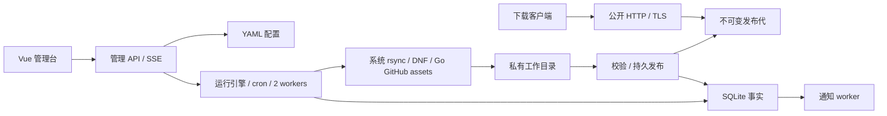

# MirrorDock 当前设计

本文件描述已实施的架构和约束。配置字段以 [config.example.yaml](../configs/config.example.yaml) 为准，运维入口见 [README.md](../README.md)，实际检查与环境限制见 [ACCEPTANCE.md](ACCEPTANCE.md)。已完成的旧计划存于 archive/plans，仅供历史参考，不作为当前规范。

## 架构与所有权

模块化单体：一个 Go 进程负责 HTTP/TLS、Vue 静态资源、管理 API、任务和通知 worker。YAML 保存配置，SQLite 保存运行事实、发布指针和通知队列；不需要 Redis 或外部任务队列。两类 worker 和公开下载有独立资源边界。

| 模块 | 职责 |
| --- | --- |
| config | 严格 YAML、路径/字段校验、注释与 revision、原子写回 |
| database | WAL/FULL、单写连接、最多四条只读查询连接、内置 schema |
| sync | 参数与进度解析、进程组控制、GitHub 身份/续传/校验 |
| runs | 持久状态机、预算/重试、同源排他、cron、分析聚合 |
| mirrors | 暂存/复制、完整性校验、发布代、受限文件根、公开目录/下载 |
| notifications | 凭据密文、终态摘要、激活边界、去重与发送重试 |
| observability | slog 初始化、独立程序日志 |
| app | 认证、同源写校验、API、SSE、TLS/连接生命周期 |
| web | Vue 路由、领域页面、共享控件与请求生命周期 |

启动顺序为配置校验 → 独立程序日志 → 数据目录锁 → SQLite → 发布恢复 → 构造引擎/认证/通知 → TLS 加载与监听绑定 → 启动 worker → HTTP Serve。监听失败不启动任务。退出先封闭管理写入口、停止 SSE/排空 HTTP，再停止后台执行器，最后关闭文件根、数据库和实例锁。只有一个进程能使用同一 state 目录。

## 配置与管理边界

用户确定的 `-f`/`--config` 协议优先于目录基线默认值；无参数读 cwd/config.yaml。相对路径以配置目录为基准，数据库为 `<path>/data.sqlite`。不恢复已删除的配置字段。监听、数据/镜像路径、TLS、auth、log 使用启动值；页面保存保留部署字段，外部修改需重载并按提示重启。

保存通过 revision 同时检测其他管理员与磁盘编辑，保留 YAML 注释，临时文件写入/fsync/rename，文件权限 0600。源编辑器保存打开时的 revision，旧编辑不能覆盖新配置。Token 与通知凭据只返回存在标记，管理员密码不参与 JSON 序列化；**完整 GitHub 代理地址按已确认协议向登录管理员回填**。所有运行快照、审计与错误日志继续脱敏。

账号来自 YAML，启动时内存 bcrypt，Cookie 会话 12h，HttpOnly/SameSite Strict，TLS 下 Secure。最多 32 会话，登录按连接 IP 每分钟最多 10 次，成功重置，最多 4096 桶且一分钟过期；不信任转发头，反代部署边界见 README。修改请求需要自定义头和匹配 Origin；管理 API no-store。SSE 最多 8 条、每秒推送，逐次校验会话，过期/退出终止流。各连接共用最多一秒的不可变序列化快照，查询与编码在缓存锁外进行；并发未命中合并为一次读取，等待读取可取消，失败不缓存，无客户端不主动查询。每客户端仍独立发送并验证会话。

源状态 API `/api/runs?latest=1` 将配置源作为参数传入 `json_each`，在一次 SQL 中按 `(source_id,id DESC)` 索引查找各源最新任务，不扫描无关历史、不逐源往返。管理运行列表、最新状态与持久详情使用只读池和请求上下文，数据库查询最多 5 秒；普通分页的计数与页内容属于同一只读事务。最多四条只读连接与单写连接隔离；外键、FULL 同步、busy_timeout 和只读限制通过 DSN 在每条新连接上启用。普通运行分页和统计保持完整历史查询。前端刷新取消旧请求，退出统一中止会话内全部 API 请求，防止旧 401 使新登录失效；页面/详情卸载取消请求与轮询，避免旧响应恢复已退出状态。

## 同步与运行状态

状态包括 queued、running、pausing、paused、interrupted 和 succeeded/failed/timed_out/cancelled。SERVICE_INTERRUPTED 在配置中仍启用且 ID/类型/dest 匹配时自动重新排队，预算耗尽转 timed_out；暂停和其他故障中断须手动处理。中断可继续并保留预算；同源暂停/中断任务继续占用源，必须先取消才能新建或改 dest。正常关闭保存实际耗时；异常断电最多丢失一个 5 秒进度检查点。关键状态立即落库。启动按 ID 每页 100 条恢复未终态，不设总条数截断。

恢复必须等待 working 执行器退出，保存 queued 成功后才入队；worker 出队再次检查 working，避免停止窗口或重复队列导致同一 ID 并发执行。运行中操作保存失败保留与执行器一致的 pausing/running 状态和源预占，执行器退出后再持久化结果；无执行器时保存失败保留 interrupted。

任务快照固定非敏感源/策略，凭证每次实际执行读取当前配置。内置两个 worker；五字段 cron、启动时区、重叠 skip。准备/扫描/传输/校验/发布、来源切换和重试等待共用累计预算，排队和暂停不计入。重试计数与等待期限持久化。TERM 后最多 10 秒 KILL 整个进程组，cron 关闭等待正在执行的回调结束。

interrupted 是可恢复状态，不进入最终通知结果流、失败统计或终态日志清理。日志写入跨块保留可能的凭据前缀，读取按 UTF-8 完整字符边界推进字节偏移。

手动日志清理用开始时的最大任务 ID 固定扫描上界，按 ID 游标读取每页最多 100 个终态任务，不做 OFFSET 或全量 count。独立清理互斥与日志打开锁协调删除；每个任务在短暂 Engine.mu 内取得清理租约，文件删除与保存发生在锁外。相同 ID 的动作等待租约完成，其他任务继续执行；重新检查当前状态/working，避免删除已恢复任务的日志。请求取消/服务关闭终止后续工作，部分删除落库，删除/保存失败可重试；事实、通知结果和已打开导出的长度不删除或修改。旧原始日志与外部备份不自动脱敏或清除，仍遵守手动清理协议。

Rsync 使用系统 PATH 中现代 rsync，数字 srcN 顺序失败切换，包括永久性来源错误；本地磁盘/权限错误停止，校验不一致可重试，rsync 23/24 仍不视为成功。模块内子目录 URL 必须带尾斜杠。不通过 shell 执行用户命令。默认递归并保留链接/时间/权限/硬链接；partial-dir 与默认单文件临时替换用于任务工作目录，不使用 delay-updates 或 inplace，整体发布由镜像模块保证。固定排除 `.mirrordock*`，避免上游和 --delete 改写内部准备标记。UID/GID 独立可选，0 有效，明确范围及权限，不自动 sudo。

Reposync 针对 DNF4，使用任务私有配置/缓存/RPM 密钥库，仅启用选定 repo；不修改宿主配置。开启 GPG 时先下载配置的公钥（每个最多 1 MiB、30 秒并受任务预算约束，拒绝 HTTPS 降级到 HTTP），用 rpmkeys 导入私有 installroot，再执行 reposync 包签名校验；不依赖插件自动导入。仅一个 src1，完整元数据与 newest_only 组合被拒绝；关闭元数据下载时按文件发布并移除旧 repodata，不承诺可安装仓库。私有 DNF 数据在任务 work 的隐藏子目录，执行结束清除，异常退出由重试/终态清理；启动另清理旧式临时目录。GPG 仅声明包签名校验，不宣称元数据签名已验证。

配置来源/GPG 地址禁止 userinfo/query/fragment，不支持 URL 鉴权；通用 HTTPURL 保留 GitHub 临时签名资产地址支持。新快照防御性脱敏。1.0 初始化全新 schema，不保留发布前测试数据的迁移代码。

GitHub 使用 go-github v88，按发布时间选 Release，仅 assets。tag 与附件名拒绝内部保留前缀/暂存名称，避免覆盖身份侧车或发布无法下载的文件。API 鉴权客户端禁止跨 origin 重定向，下载客户端不向第三方资产主机附带 API Token。下载身份侧车包含 ID/大小/更新时间/digest；验证完整文件后复用，Range 206 和身份均匹配才续传，否则重新开始。凭据/签名 URL 不进入错误正文。HTTP/HTTPS/SOCKS 代理使用每轮连接池，空值直连，不读取系统代理变量，故障不绕过代理。正文单次读取空闲五分钟取消并保留续传数据；API 配额按服务端重置期限重试，预算不重置。prune 开关同时清理保留 tag 中已取消选择的附件，且只在本轮下载全成功后进行。

接收统计与处理进度分离：Rsync 读取统计输出，GitHub 累计实际正文读取；跨尝试累加，未知尝试保留缺失标记，Reposync 不推算。数据分析按创建日和启动时区聚合成功任务最终快照，不把复用字节当网络流量。

## 发布与恢复

工作目录为 `<mirror_root>/.mirrordock/work/<run-id>`，代为 `.mirrordock/published/<uuid>`。启动、环境检查刷新与准备前均在真实 published/work 目录创建小文件实测克隆。Linux FICLONE、Darwin APFS clonefile 原生克隆必须成功，失败保留错误并停止同步，不回退完整复制，不硬链接可变正文。克隆完整后才写准备标记；暂停继续复用同一工作目录。失败不替换公开代。

准备标记保存基础发布代 ID 与工作树元数据指纹。同步后先验证镜像，基础代仍一致且路径、类型、权限、所有者、大小/mtime、文件 inode/ctime 与符号链接均未变化才删除工作目录、复用当前发布。内部标记与根目录 mtime 排除，不读取包正文；旧格式标记禁用此优化。文件被替换或内容写入，即使大小/mtime 相同也保守创建新代。

克隆按 dev/inode 保留工作树内部硬链接组，组内首个文件原生 reflink，其他路径链接到该 work 文件，绝不链接到 published。GitHub 更新私有同步时间后恢复父目录 mtime；正文不变时仅持久化更新发布摘要，不改变当前代 ID 或公开文件，摘要保存失败保留旧事实和 work。

Linux statfs 使用 Frsize（缺失时回退 Bsize），Darwin 使用 Bsize。普通 statfs 故障仅记录错误、阻止新准入；只有明确低容量才取消活动任务。容量读取实际 work 文件系统的总量与可用量，不累加 reflink 目录逻辑大小。两个 worker 共用准入锁：可用量需达到 max(1 GiB, 总量 1%) 加每个活动 worker（含新任务）512 MiB。准入不足保持 queued/waiting_space，不消耗累计预算；运行中独立每 5 秒检查，低于安全余量取消执行器，持久化 DISK_SPACE 失败并保留旧发布。该机制不能保证上游增长或外部写入不触发 ENOSPC。

启动、终态与每 5 分钟由独立清理循环回收，单次上下文上限 30 秒。work 清理查询持久化 state，仅移除 succeeded/failed/timed_out/cancelled；可恢复状态和未知目录不删，终态保存失败保留源预占。删除按 128 项批次检查取消并协作让出；过期且无引用的旧代先改名为 `.gc-<id>`，中断后继续回收，避免删除导致 mtime 更新而再延后 24 小时。

RPM 流式解压 gzip/bzip2/xz/zstd 索引，校验已声明元数据 SHA-1/SHA-256/SHA-512 和包大小；SHA-1 仅用于旧仓库一致性，不作为签名依据。APT 识别根目录或 dists/<suite> 下的 Release，优先 InRelease，校验实际存在的 SHA-256 索引并流式读取 Packages；允许不存在的未压缩副本和排除的架构，但全部索引缺失仍拒绝。Release 超过 8 MiB 时拒绝，不能截断后当成校验通过。不每次计算所有包内容哈希；客户端签名验证仍适用。

校验完成后 fsync 正文/目录，密封代、生成 manifest/大小摘要，预验证公开链接和 os.Root，提交 SQLite 指针，再切换内存路由。提交失败回滚；首次导入已有目录的数据库提交失败会恢复原目录。重启根据已提交指针修复链接，未引用代不公开。部署需避免在导入/发布过程中直接移动目录；断电与磁盘故障仍须目标环境演练。

请求固定发布代并持有引用，借用有界缓存的当前/旧代根，仅在打开真实文件期间保留根租约；文件与代引用持续到请求结束。根的相对路径在安装路由时验证并固定。旧代至少保留 24h，当前路径缺失的旧包可回退读取；到期且无引用才回收并驱逐缓存根。源删除只撤销路由/计划，保留文件。启动和配置更新共用 Reconcile，支持已有目录导入、已删除源重新添加/换 ID、dest 迁移；仅删除指向本源发布代的旧链接。多份历史记录同 dest 时优先采用当前链接指向的记录，否则选最新提交的代。YAML 保存与文件系统接入不是跨介质事务；接入失败须明确告知已保存并要求修复后重载。

## ADR-010：下载性能与资源隔离

公开文件服务直接持有真实 `*os.File`，标准库 ServeContent 处理 Range/HEAD/条件请求。计数 ResponseWriter 实现并委托 `io.ReaderFrom`，普通文件和单段 Range 保留 LimitedReader 形态。Linux HTTP/1.1 可沿标准库调用链使用 sendfile；**实际命中必须由 Linux 系统调用观测确认**。多段 Range 流式 multipart，过量有效范围忽略 Range 返回 200。

HTTPS/HTTP2 采用标准库有界 TLS/流控，不宣称 sendfile，不向 TLS 底层写明文。下载热路径不访问 YAML/SQLite，不记录逐块正文，不计算整文件哈希，不动态 gzip/Brotli。ETag 基于不可变代、路径、大小和时间，缓存上限 8192。

| 资源 | 内置界限 |
| --- | --- |
| 大文件下载 | 256 条活动流 |
| <=256 KiB 小文件 | 独立 64 条活动流 |
| 目录渲染 | 独立 8 条，最多列 1000 项 |
| SSE / 管理会话 | 8 / 32 |
| TCP | 按 FD 预留，最多 4096 |

文件打开前还有全局 FD 配额，GET/HEAD/目录/HTTP2 流均受限：reserve=min(256,软限制/2)，TCP 至多 (软限制-reserve)/2，文件请求至多 (软限制-reserve)/6 且最多 328，每请求按最多 3 个瞬态描述符预算。根不与所有保留代一一常驻，空闲 FD 数量受缓存上限约束。

根缓存最多 min(32, max(0, reserve/4-1)) 项，另保留一个镜像锚点，消耗至多四分之一预留额度；软限制 128 时为 15 项。LRU 只驱逐无租约根，全部被借用时额外请求使用瞬态根并计入请求 FD 配额。冷路径在缓存锁外执行文件系统查找，再在锁内检查关闭/重复打开并安装；关闭或回收时移除缓存，活动租约在最后释放时关闭。元数据缓存采用结构键，命中不构造 ETag 字符串键，Content-Disposition 与不可变元数据共同缓存。

资源饱和返回 503/Retry-After；大文件超过 75% 容量时暂缓新同步，正在执行的任务继续；排队任务记录 waiting_downloads 阶段和事件。旧代回收遵守引用保护并按批次让出，避免下载长期繁忙时一直不回收。Linux 同步尝试 nice=10 与 best-effort I/O priority=7，不锁住公开下载。os.Root 限制文件读取，拒绝外链、FIFO/设备、私有标记与非规范路径；不存在文件不回落到整个磁盘根。

每 30 秒通过原生 TCP 统计检查无进展，整个连接 5 分钟无进展才关闭，不限制正常有进展下载的总时长。Linux 读取已确认字节，macOS 读取非重传发送字节；HTTP/2 任一流持续进展避免误关整连接。当前编译/运行仅支持 Linux 和 Darwin，不承诺其他 Unix 平台。

本机合成吞吐只能验证当前构建的性能边界。生产须分别验证 HTTP/HTTPS、HTTP2、并发 Range、冷/热缓存、慢客户端、同步与下载同时进行时的 CPU/RSS/FD/吞吐/管理延迟，以及 Linux sendfile 与 EL 安装结果。

## 通知与前端

通知配置在 YAML，AES-256-GCM 密钥在 state；已有密文时缺失密钥阻止启动。激活边界、终态快照与 `(channel,run_id)` 去重在 SQLite。启用时在同一个 SQLite 快照内固定任务 ID 边界和结果插入序号；按单调递增的结果序号每次读取最多 100 条，只在入队全部成功后推进持久游标，晚完成任务不会漏发，失败可依靠唯一键重放，不反复扫描整段历史。发送记录分页在五秒可取消的只读事务内读取计数和页面，不占用写池。最多 3 次发送、30/60 秒退避，不影响同步结果；外部已收但确认丢失可重复投递。只发送脱敏摘要，不发送业务文件或原始错误。

通知处理耗时使用累计 ElapsedSeconds，旧记录缺失时显示未记录。GitHub 复用计数为成功的子集；Rsync 单列条目总数（含目录）与传输普通文件数，不推算未完成；Reposync 不推算包数。通知直连及 Webhook 无签名的当前功能边界见 README。

Vue 以 app、features、components、layouts 分层，七类页面（含概览）按需加载，颜色由 CSS 变量令牌提供深浅两套主题，公共 OptionCard/分页/时间范围统一复用。运行详情以同步阶段、实际接收/处理量/耗时/尝试统计、来源尝试及日志/快照折叠区组织，窄屏统计改为两列。日志默认收起，展开读取，收起/隐藏/卸载取消请求；历史选择、滚动跟随和已读偏移保留。状态在活动、暂停或中断时轮询，四种不可恢复终态停止；可手动刷新。终态发生在日志请求中途时额外补读，超过单轮 2 MiB 的积压分轮读到 EOF，避免提前停止漏掉尾部。返回前台重新校对状态和展开的日志；弹窗焦点范围包含原生 summary 控件。公开目录由 mirrors 自有嵌入模板生成，不经 Vue。HTML 转义文件名，脚本只读 DOM data 属性，CSP 使用固定脚本 SHA-256；无脚本可浏览已列出链接。超过 1000 个可见项明确提示，搜索排序仅针对所列子集，完整文件路径仍可下载。公开项目状态最多两次批量 SQL 并缓存一秒，绑定请求取消；文件正文路径继续不访问 SQLite。设置草稿保留并在实际设置冲突时显式要求用户处理；系统页显示 CLI 注入的真实构建版本。
